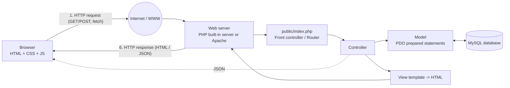
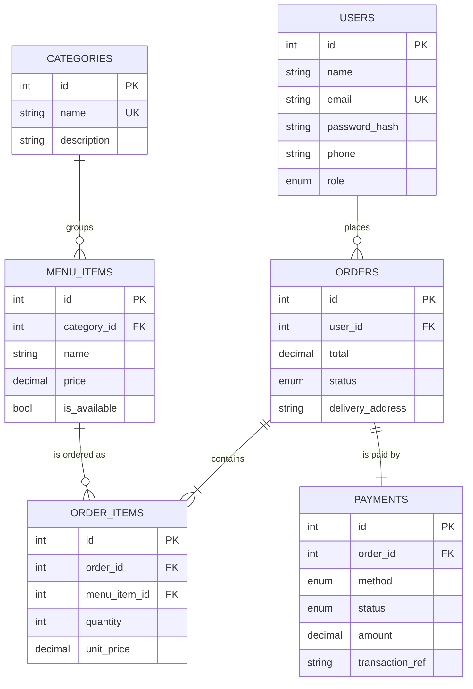

# FoodHub – Assignment notes (CIS324)

Use this file as the base of your report. Add your own screenshots (Q3) and rewrite in your own words.

## Q1 – Front-end / back-end interaction (with architecture diagram)

Trace of "Add to cart / Place order": the browser sends a request (1) over the Internet to the web server (2); the server
runs `public/index.php`, which picks a controller from the route table (3); the controller validates input and calls a model;
the model runs a prepared SQL query on MySQL (4); the controller fills a view (5) and the web server returns HTML or JSON (6)
that the browser renders. HTML = structure, CSS = presentation, JavaScript = behaviour (live search, payment form toggle, fetch).

## Q2 – Web Development Life Cycle and standards
| Phase | In FoodHub |
|---|---|
| Planning | Goal: online ordering + restaurant management; users = customers and admin; scope, deadline 30 Nov 2026 |
| Analysis | Requirements: browse menu, cart, pay, track orders, manage menu/orders, secure login |
| Design | MVC structure, ER diagram, wireframes (cards grid, tables), colour palette with good contrast |
| Development | PHP/MySQL code in `app/`, CSS/JS in `public/assets` |
| Testing | Manual test cases (see Q5), try invalid input, role tests (customer cannot open /admin) |
| Deployment | XAMPP/Apache or any PHP host; run `setup.php`, set `debug => false`, enable HTTPS |
| Maintenance | MVC separation, admin CRUD for content, backups of MySQL, dependency-free code |

Standards / accessibility used: semantic HTML5 (`header`, `nav`, `main`, `footer`, `fieldset/legend`), `label` for every input,
skip-link and visible focus outline, responsive layout (CSS grid + media query), colour contrast ≥ 4.5:1, `aria-live` for messages,
`lang="en"`, UTF-8, keyboard operable forms.

## Q3 – Functional pages (take screenshots of each)
Home, Menu, Cart, Checkout, My orders, Order details, Login, Register, Admin dashboard, Admin orders, Admin menu items, Admin categories.
| Requirement | Where |
|---|---|
| Operators / conditionals | `Cart::deliveryFee()` (free delivery over ৳500), `CheckoutController` (payment switch) |
| Loops / arrays | views (`foreach` over items), `Cart::lines()`, `Cart::subtotal()` |
| `$_GET` / `$_POST` | menu search (`$_GET['q']`), login/register/checkout (`$_POST`) |
| Sessions | login (`$_SESSION['user']`), cart (`$_SESSION['cart']`), flash messages, CSRF token |
| Cookies | `remember_email` cookie on the login page (HttpOnly, SameSite) |

## Q4 – Database / ER diagram

Justification (3NF): each fact is stored once. Categories are separate from items (no repeated category names); order lines are in
`order_items` (many items per order); `unit_price` is copied so old orders keep their price; payments are separate (1:1 with orders).
CRUD with prepared statements: **menu items** (`AdminMenuController`, `MenuItem`), **categories** (`AdminCategoryController`, `Category`),
plus orders (read/update/delete) and users (create/read).

## Q5 – Validation and threats
| Threat | Before (vulnerable) | After (FoodHub) | Test case |
|---|---|---|---|
| SQL injection | `"SELECT * FROM users WHERE email='$email'"` | `prepare('... WHERE email = :email')` + `execute([':email'=>$email])`, real prepared statements (`EMULATE_PREPARES=false`) | Log in with `' OR '1'='1` → "Invalid e-mail or password" |
| XSS | `echo $_POST['name'];` | `e()` = `htmlspecialchars(..., ENT_QUOTES)` on every output, `strip_tags` on input, CSP header blocks inline scripts | Register name `` → rejected by regex / shown as text |
| Weak password storage | `md5($password)` / plain text | `password_hash(PASSWORD_DEFAULT)` + `password_verify` | Look in `users.password_hash` – bcrypt hash starting `$2y$` |
| CSRF | forms without token | `csrf_field()` + `csrf_check()` (`hash_equals`) on every POST and the JSON API | Submit a form with a missing token → HTTP 419 |
| Brute force | unlimited attempts | 5 failures → 60 s lock | Try 6 wrong passwords |
Server-side validation uses regular expressions (`preg_match` for name, phone, password strength, card, bKash ID, price) and string functions
(`trim`, `strip_tags`, `mb_strlen`, `strtolower`, `ucwords`, `addcslashes`) – see `AuthController`, `CheckoutController`, `helpers.php::clean()`.
Payment safety: Luhn check, only last 4 digits stored, CVV never stored, total always recalculated on the server from DB prices.

## Q6 – Web API vs form submission
Endpoints: `GET index.php?r=api/menu&q=burger` (JSON list) and `POST index.php?r=api/cart_add` (JSON body, `X-CSRF-Token` header).
Consumed by `public/assets/js/app.js` with `fetch()` (live search and add-to-cart without reloading).
| | fetch / AJAX + JSON | Traditional form + reload |
|---|---|---|
| Performance | Only small JSON is transferred | Whole HTML page re-sent |
| User experience | Instant, keeps scroll/position | Full page refresh |
| Coupling | Front-end depends on the JSON contract (loosely coupled, reusable by a mobile app) | Server renders HTML, tightly coupled to views |
| Security | Needs CSRF header, JSON validation, output escaping in JS (`textContent`) | Simple; browser handles form + cookie, CSRF token in form |
| Without JavaScript | Needs fallback (we fall back to the normal form) | Works everywhere |

## Q7 – State management and hardening
Implemented in `app/core/Session.php` and `AuthController`:
1. `session_regenerate_id(true)` on login/register/logout → prevents session fixation.
2. Cookie flags `HttpOnly`, `SameSite=Lax`, `Secure` (auto on HTTPS); `use_strict_mode`, `use_only_cookies`.
3. 30-minute inactivity timeout and a user-agent fingerprint check → limits session hijacking.
4. `password_hash` / `password_verify`; login throttling; role checks (`requireAdmin()`) on every admin action; customers can only open their own orders.
Trade-offs: short timeout is safer but logs users out while they are choosing food; the fingerprint can log out users whose browser string changes;
bcrypt is deliberately slow (about 50–100 ms per login) – acceptable for security; `Secure` cookies need HTTPS (not available on plain localhost).

## Q8 – MVC
| Role | Files |
|---|---|
| Model | `app/models/*.php` (SQL and business data) |
| View | `app/views/**` (HTML templates, escape output only) |
| Controller | `app/controllers/*.php` + router `public/index.php` |
| Maintainability | Small single-purpose files; change a page without touching SQL | Procedural: SQL, logic and HTML mixed in each page, duplicated code |
| Scalability | New feature = new controller/model/view; a team can split work | Each new page copies old code, hard to grow |
| Testability | Models and validation can be unit tested; views are logic-free | Hard to test because logic is tied to HTML output |
Cost of MVC: more files and a learning curve; for a 3-page site, procedural PHP is quicker.

## Q9 – Concluding statement (adapt)
FoodHub uses PHP MVC with PDO prepared statements, bcrypt password hashing, CSRF tokens, output escaping, a strict Content-Security-Policy,
hardened sessions and role-based access, so it is secure; the MVC layout and a normalized MySQL schema make it easy to maintain and extend,
and the built-in cash/card/bKash flow, order tracking and admin tools fit a real restaurant. **Main limitation:** payments are simulated
(no real gateway) and there is no e-mail/SMS notification or HTTPS configuration. **Improvement:** integrate a real payment gateway
(e.g. SSLCommerz or bKash API) with webhooks and send order-status notifications.
